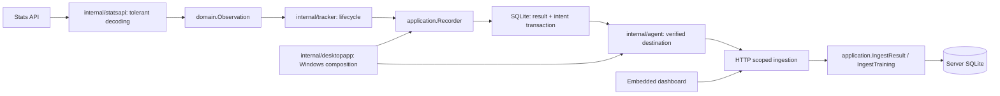
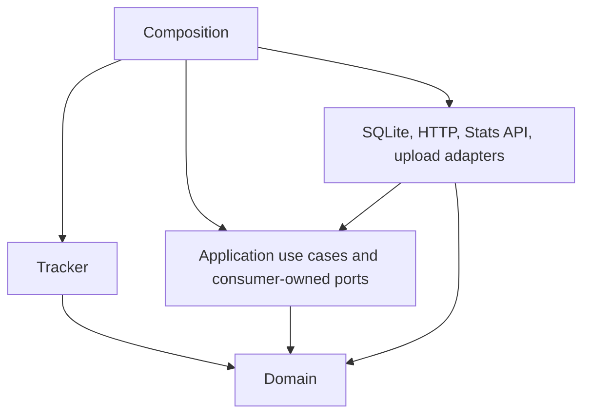

# Architecture and domain map

Rocket Tracker records a player's game telemetry and presents history,
statistics and training aids. It has a Windows desktop executable and a
separate self-hosted server. Both embed the same dashboard from `web/`.

## Runtime ownership and hexagonal boundaries



The root Windows entry point delegates to `internal/desktopapp.Main`. The desktop
package composes collection, application ports, local HTTP, setup, tray and
updates. `cmd/rltracker-server` composes the server. CLI commands, data paths,
autostart arguments and the shared build version remain compatible.

The tracker accepts domain observations, maintains the match lifecycle and
invokes injected save functions. It imports neither store nor Stats API DTOs.
`statsapi.ObserveEvents` maps tolerant external packets to observations without
turning absent values into measurements. Domain owns match/training values,
profile identity, normalization, training merge and measurement availability.
Store exposes compatibility aliases, owns SQL, user scoping and deduplication.



`application.Recorder` calls a narrow atomic local-record port and notifies only
after success. Server ingestion validates values and delegates to an explicitly
authorized scoped port; it never queues an upload. Read handlers continue to use
scoped store queries directly: there is no interface per SQL table.

See [ADR-0001](decisions/0001-architecture-hexagonale.md) for the boundary decision
and [ADR-0002](decisions/0002-livraison-durable.md) for delivery guarantees.

## Data and domain vocabulary

| Concept | Current representation and meaning |
|---|---|
| Server user | OIDC-backed account; owns stored data and devices. Local mode uses `store.LocalUser`. |
| Rocket League profile | The in-game account represented by `Match.Me`; `domain.ProfileKey` (also available through `store.ProfileKey`) prefers a normalized platform ID, then a normalized name. A user can have several profiles. |
| Match | One player's perspective of a game, with `win`, `loss` or `abandoned` result, player/team snapshots and optional telemetry. Stored once per user, GUID and profile (`matches.profile`); offline matches also match on their start time, so a live upload and a later import give one row. Rows without a profile match any profile. |
| Partial match | Collection began after the game started; earlier events can be absent. `Partial` preserves this distinction. |
| Device | An upload credential associated with a server user. Revoking it stops future authenticated device requests. |
| Training | A game-observed solo offline session or browser warm-up timer; nearby observations can merge. Focus and account are separate fields. |
| Manual day | Hand-entered counts of games/wins for a date and mode, rather than reconstructed telemetry. |
| Rank/MMR entry | A manually recorded observation. The Stats API does not supply MMR. |
| Play session | An analytical grouping based on a 30-minute gap, distinct from an authentication session. |
| Authentication session | Server-side login record plus a browser cookie. |

Tracking and inference rules are implemented in `internal/tracker/`: explicit
player IDs/names take precedence over camera-based identity detection; spectator
signals constrain automatic detection. Solo offline play of at least one minute
can become training. An interrupted sufficiently progressed match can be saved
as abandoned and later replaced after reconnection.

`Match.Tag` is an editable classification, not an authoritative playlist from
the game. Speeds carry an explicit source unit when established; unknown telemetry is
not converted from its magnitude (see SPEC.md). touch/goal positions use the tracked player's team orientation. Older
records can lack movement, touch points, goal impacts or demolition data. Check
the source and [SPEC.md](SPEC.md) before changing units or missing-value rules.

## Saving, delivery and editing

The local recording port commits each result or training and its delivery intent
in one SQLite transaction when a server is configured. No configured server means
local-only recording. An unknown destination identity produces a held intent;
an unreadable configuration fails recording explicitly. The dashboard timer uses
the same local training port. The tracker retains immutable failed save snapshots
and retries them on following observations while keeping new game state separate;
a failed snapshot does not block independent later records;
flush reports failures
without silently discarding the result. These precommit snapshots are in memory;
forced process exit after an unresolved failure can still lose them. Checkpoint warnings after a commit do not undo it.
Local-only recording has its own persisted origin, distinct from an unknown
historical origin and a configured destination. Local merge candidates must
share their persisted destination origin, including
after an intent is acknowledged. Explicitly different training profiles remain
separate; unknown historical origin is not assigned from current credentials.

```mermaid
sequenceDiagram
 participant T as Tracker / local timer
 participant U as Recorder
 participant DB as Local SQLite
 participant W as Agent
 participant S as Server
 T->>U: Record result or training
 U->>DB: BEGIN; save + intent; COMMIT
 DB-->>U: durable local record
 U-->>T: saved
 W->>S: authenticated heartbeat
 S-->>W: installation ID + account ID
 W->>DB: pending for verified destination (up to 100)
 W->>S: send stable key and payload
 S-->>W: accepted or permanent rejection
 W->>DB: acknowledge/reject only this revision
```

The queue belongs to an installation and authenticated account, not a token.
Each upload pass verifies the destination before reading payloads. Retries retain
the transport key. Changed payloads increment revisions; late acknowledgements
cannot erase newer payloads. Rejected records remain diagnosable. Local status
exposes pending, held, rejected and legacy-held counts without credentials.

Setup owns a configuration generation. Cooperating readers/writers serialize
on the stable `agent.json.lock` file (`flock` on supported Unix hosts,
`LockFileEx` on Windows). A heartbeat compares generation and target under that
lock before patching the current file; an old reply cannot restore previous
credentials or settings after setup/disconnect. The lock is not held during
network requests. The agent owns its configuration and identity snapshots;
reload adopts settings with the target and clears provisional auto-detection.
Local recording also reads the current configuration and commits under this
cooperating lock, so a confirmed setup change cannot reuse an agent's stale cached
destination. Old binaries or external editors that ignore the lock do not share
this guarantee.

Legacy file queues, including rejected files and server-switch asides, are
preserved and copied to a held journal. Current credentials never assign their
historical owner. Recover them by explicit scoped import after checking the
account and destination. See [OPERATIONS.md](OPERATIONS.md) and
[ADR-0002](decisions/0002-livraison-durable.md), including downgrade limits.

Connecting a server does not import all earlier local history. Use
`rltracker agent import` or the dashboard import explicitly. Browser edits of tags,
focus and rank observations remain writes to the selected store; this is not
bidirectional replication. Replay preserves existing edited tags and focuses.

Shutdown cancels and joins the game client before tracker flush, attempts a
bounded final upload, joins the agent, and closes SQLite before releasing the
single-instance lock and restarting an installed update. A failed HTTP startup
also cancels capture. A timeout is never treated as evidence that a writer has
stopped.

The server authenticates device requests separately from browser sessions.
Shared player pages intentionally allow authenticated read-only access to other
players; mutation routes use the signed-in user's scope. User isolation and
intended social visibility must both survive refactoring.

## Browser and analytics

`web/app.js` begins with pure analytical functions exported through
`module.exports` for Node and a browser global. Its remaining section owns
requests, routes, mutable page state, rendering, live views and warm-up timers.
The dashboard generally loads match history and computes analytics in the
browser. Server leaderboards use store aggregates.

Status is polled every three seconds. `/status` carries `data_rev`, an
in-memory per-user revision that changes on every own write; the lists reload when
it changes (or, from an older server, when the counts change). A failed load is
retried at the next poll. Generation checks on the history loaders, and a
sequence on the leaderboard, reject responses from an earlier request.
`shared_rev` separately invalidates shared-match joins when another user adds or
deletes a perspective. Its process-wide invalidation can over-refresh safely.
Older servers use periodic shared-list refresh, and failures retain a retry.
Selecting an in-game profile filters already-loaded data.

Training suggestions and live historical win rates are descriptive calculations
from the available sample. They are not evidence that a mechanic causes a win,
nor an official matchmaking prediction. Keep sample size, eligibility and
missing telemetry explicit in changes to those features.

## Further reading

- [Development and verification](DEVELOPMENT.md): commands, platforms and CI.
- [Specification](SPEC.md): detailed payloads and detection rules; verify older
  launch descriptions against the current entrypoints.
- [Self-hosting](SELF_HOSTING.md): authentication, proxy, devices and backups.
- [Agent guide](../AGENTS.md): change rules and source navigation.

## Active training time

Training wall timestamps remain the session envelope. Optional `active_intervals`
contains `{started_at, ended_at}` pairs inside it: absent/null keeps the historical
full-span meaning; an empty array means zero measured activity. Timer pause closes
an interval and resume opens another, including after reload and across blocks.
Validation rejects impossible intervals; merging uses their union and preserves
the twelve-hour maximum envelope by keeping incompatible sessions separate.
See [ADR-0006](decisions/0006-temps-actif-et-frontieres.md).

## Untrusted import and authentication adapters

Uploaded SQLite files use a read-only streaming reader with contextual SQL and
an allowlist of ordinary schema objects, separate from the application store's
migration/repair path. CSV exports neutralize formula-leading text fields.
Upload clients refuse redirects before forwarding payloads or device credentials.
OIDC UserInfo claims are used only when their subject matches the verified ID
token. HTTPS browser cookies use the `__Host-` namespace with Secure and Path=/;
explicit loopback HTTP retains development compatibility. See
[OPERATIONS.md](OPERATIONS.md) for import limits and [SELF_HOSTING.md](SELF_HOSTING.md)
for the hosting boundary.
