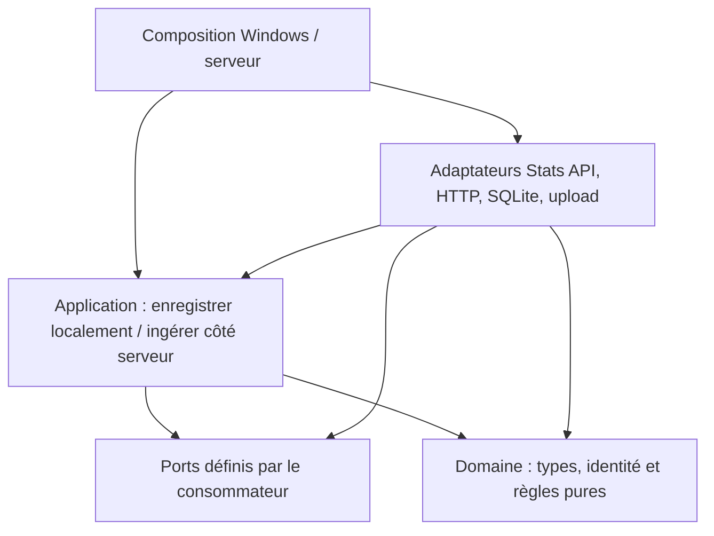

# ADR-0001 — Séparer domaine, application et adaptateurs dans un module Go

- Statut : Proposé
- Date : 2026-10-18
- Décisionnaire : mainteneurs
- Point de départ : [révision auditée](https://github.com/KcivazB/rocket-tracker/tree/6f531fd43be3bcd6f3a746e3b352103ef2a06ef3), [audit et schémas](https://github.com/KcivazB/rocket-tracker/issues/2)

## Contexte

Le tracker utilise les modèles du package SQLite et les DTO Stats API. La composition Windows mélange lifecycle et orchestration des écritures. Le même module Go fournit déjà l’application Windows, le serveur, SQLite et les assets web embarqués. Un déplacement de dossiers ne rend pas les règles indépendantes des effets.

## Décision proposée

Conserver un module et deux exécutables. Extraire par parcours les types/règles purs utiles dans le domaine, puis les cas d’usage locaux d’enregistrement et ceux d’ingestion serveur. Les ports sortants appartiennent à leur consommateur ; réutiliser les adaptateurs existants et les fonctions injectées. La composition câble les callbacks ; le tracker n’importe pas l’application ou l’agent.

Le domaine ne dépend pas de SQL, HTTP, Windows ou du JSON Stats API. Un mapping transforme les données externes en observations métier en préservant l’absence. Une ingestion serveur utilise un propriétaire autorisé et ne remet pas de données dans la file du PC.

## Dépendances cibles proposées

Les flèches représentent les dépendances de code, pas le sens des données. Cette vue ne décrit pas une migration déjà terminée.

La composition relie les événements entrants aux cas d’usage et fournit les implémentations des ports. Le domaine n’importe ni application ni adaptateur ; la livraison réseau reste un effet explicite du parcours local.

## Options et conséquences

Une réorganisation de fichiers seule est insuffisante. Des modules Go/services séparés ajoutent du coût sans besoin démontré. L’extraction progressive permet de garder des alias de compatibilité temporaires et de livrer des correctifs sans attendre la migration complète. Les lectures qui ne changent pas n’exigent pas une interface par table.

Préserver commandes, JSON, chemins de données, version injectable (voir [ADR-0003](0003-version-et-artefacts.md)), sélection de plateforme, assets et lifecycle. La séparation des couches n’apporte pas à elle seule l’atomicité DB/file : voir [ADR-0002](0002-livraison-durable.md).

## Validation et mise en œuvre

Vérifier imports/cycles, règles avec doubles, upload/import scoped et parcours Windows/serveur. Les séquences distinguent échec DB, checkpoint et livraison. Les fichiers Windows et l’arrêt/restart nécessitent leurs preuves propres. Aucun refactor achevé n’est déclaré par cet ADR ; les PR préciseront les tranches et couplages restants. Revoir si un autre consommateur ou une contrainte de plateforme rend les frontières inadaptées.

## Mise en œuvre proposée et adoption

Le code de cette proposition et les contrats actuels sont décrits dans
[ARCHITECTURE.md](../ARCHITECTURE.md), [SPEC.md](../SPEC.md),
[OPERATIONS.md](../OPERATIONS.md) et [RELEASING.md](../RELEASING.md).
Les preuves finales sont liées dans le suivi d’implémentation et la PR.
L’autorisation d’implémenter ne vaut pas acceptation des mainteneurs, intégration
ou release. Pour ADR-0005, la séparation technique est appliquée ; politique de
partage et intégration plateforme restent des décisions produit distinctes.
