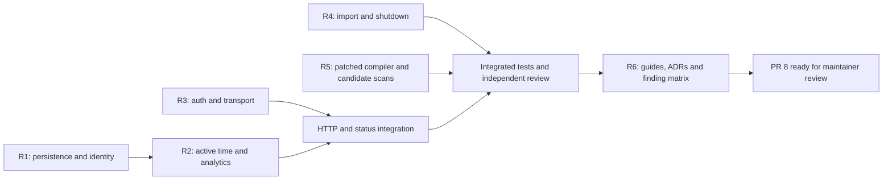

# Issue #9 — remediation plan

Starting revision: `1369874f2db0a7cf93ad793f1b57cf627e526f59`, PR #8.
This task plan is temporary. Durable decisions belong in ADRs; current contracts
belong in the architecture, specification, hosting, operations and release guides.
This proposal corrects the 22 findings in [audit #9](https://github.com/KcivazB/rocket-tracker/issues/9).
It does not authorize a merge, release or deployment, or attest real-game/Windows/
IdP/production qualification. Proposed ADRs remain proposed until maintainer acceptance.

## Personas, epics and stories

The existing P1–P4 and US-01–11 remain the product vocabulary, not interviews.

| Epic / step | Persona / story | Required result | Findings | Documentation in the same change |
|---|---|---|---|---|
| R1 — Preserve records and identity | P1/P2, US-01/02/08/09 | Failed saves retain immutable results; explicit profile and persisted origin constrain every merge; setup switches recording atomically | ARCH-01/02/03/04/05 | ARCHITECTURE, ADR-0002/0005 implementation notes; regression scenarios and compatibility |
| R2 — Honest analysis | P3, US-03/04/06/07/10 | Correct variant cohorts, active training, independent telemetry eligibility, qualified timelines, shared invalidation, duel units and settings | PROD-01…08 | SPEC, FR/EN help, ADR-0004 implementation notes |
| R3 — Secure boundaries | P4/P2, US-08/09 | CSV text stays text, uploads keep their destination, claims keep their subject, login cookies resist sibling injection | SEC-1/2/3/5 | SELF_HOSTING and threat/cookie contracts; endpoint negative regressions |
| R4 — Untrusted imports and lifecycle | P4, US-09/11 | Read-only schema-checked source, contextual SQL and streaming rows; cancelled work releases admission; shutdown joins owned workers | SEC-4, ARCH-06 | OPERATIONS, ARCHITECTURE, import and Discord contract, adversarial cancellation tests |
| R5 — Patched candidate and recovery help | P4/P1, US-11 | Patched compiler/dependency, scans of actual candidates, one usable backup/recovery path | BUILD-01, DEP-01, DOC-01 | DEVELOPMENT, RELEASING, README, SELF_HOSTING, OPERATIONS |
| R6 — Integration and review | all | Every finding mapped to code, regression and current guide; review stable head | all 22 | Evidence/status matrix, issue update, exact CI/head and remaining external gates |

## Execution contract

- Preserve Go module/SQLite/embedded assets, tolerant historic imports, edited
  tags/focus, local-only and historical unknown origins as distinct states.
- A transport key cannot erase an explicitly different profile. Result and intent
  commit together, and failed attempts remain owned before commit.
- A merged training remains valid (12-hour bound); split into separate valid
  records when a proximity merge would exceed it. Do not silently truncate.
- Timer wall timestamps describe chronology. Optional `active_intervals` describe
  actual activity; absent/null preserves historical full-span semantics, an empty
  list means zero. Intervals are bounded, normalized and unioned on merge; pause
  gaps are not activity. UI counters and warmup eligibility use that same duration.
- Shared data has independent invalidation and retry; personal `data_rev` alone
  cannot invalidate a relation changed by another writer.
- Upload redirects are refused before a second request. UserInfo subject must
  match the verified ID token before any claim is used. HTTPS security cookies
  use a host-bound namespace, with explicit loopback HTTP compatibility.
- Untrusted SQLite is a read-only source, never an application database to migrate
  or repair. Validate plain expected tables and execute source reads with the
  caller's cancellation, without abandoned background workers.
- Discord is best-effort; shutdown owns cancellation/join. A cancellation must not
  checkpoint an unsent recap as success. No exactly-once guarantee is invented.
- No numbered source version changes: `buildinfo.Version=dev` + linker injection.
  Use a patched toolchain and inspect/scan the produced binaries as well as source.

## Ownership and ordering

R1, R2 and the security portion of R3 have disjoint code owners. Coordinator owns
R4/R5, shared-revision store API and documentation integration. Shared files are
serialized, not edited concurrently. Each owner supplies tests and a handoff;
coordinator stages only the agreed files after inspecting that handoff.

R1 provides active-interval model to R2. R3 wires the shared revision exposed by
the coordinator to R2. R4/R5 are independent until integration. Commits remain on
PR #8; no new dependent PR is needed while its upstream base cannot point to a
fork-only branch. The remaining merge order is #8 after current-head review and
checks. Never merge the superseded #6/#7 separately.

## Acceptance and review

Use the audit's public probes as counterexamples, invert assertions into permanent
regressions, and retain original tests. Run focused tests during work, then all
portable Go packages, race/vet, four Node scripts, Windows compilation/tests via
CI, Linux build, version injection, workflow validation and artifact scans.
Independent review covers Principal Engineer, Product Engineer, SRE and security;
record evidence, missing coverage and dissent at one stable target.

Game capture/physical units, interactive Windows, real browser/IdP/proxy, target
capacity and hardware/RPO/RTO qualification remain explicit external gates. A
code fix, a local test, hosted CI, merge and deployment are different states.
Warmup person-vs-profile and deletion replication are open policy questions from
the audit, not additional bugs silently decided in this correction pass.

## Dependencies and evidence handoff

The integrated timer POST budget is 512 KiB on both dashboard and device routes,
with full-envelope validation before writes. This follows the 4096-interval
model ceiling; a permanent HTTP regression covers that upper count and rejection
of trailing values and oversized bodies.
